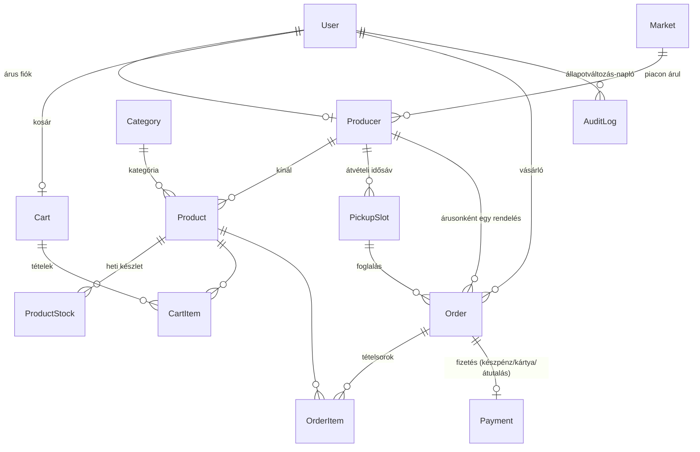

# Adatmodell

A modell a `localmarket-preordersystem.Domain/Entity` osztályaira és az `Infrastructure/Persistence/Configurations` EF konfigurációkra épül (PostgreSQL).

| Entitás | Szerep |
|---|---|
| User | felhasználó, szerepkör: Customer / Producer / Admin |
| Market | piac, nyitvatartási napok (admin állítja) |
| Producer | árus adatlap, jóváhagyási állapot |
| Category, Product | termékek, mértékegység, allergének |
| ProductStock | heti készlet és ár (`xmin` optimista konkurencia) |
| PickupSlot | átvételi idősáv, `BookedCount` |
| Cart, CartItem | több árusból álló kosár |
| Order, OrderItem | rendelés és tételsorok, állapotgép |
| Payment | fizetési mód és állapot |
| Logs (AuditLog) | kritikus módosítások naplója |

## Rendelés-állapotgép

`Pending -> Accepted | PartiallyFulfilled | Rejected | Cancelled | Expired -> Ready -> PickedUp | NotPickedUp -> Disputed -> (admin döntés: PickedUp | Cancelled)`

| Szabály | Időkorlát |
|---|---|
| Elfogadás, részleges elfogadás, „átvehető” | az idősáv végéig |
| Vevői lemondás | függő rendelés: az idősáv kezdetéig; elfogadott: a kezdés előtt `Orders:CustomerCancellationCutoffHours` órával (alapból 12) |
| Árusi / piacvezetői lemondás (indoklással) | az idősáv végéig |
| Átvéve | legkorábban az átvétel napján |
| Nem jött el | az idősáv vége után |
| Lejárt (`Expired`) | a függő rendelés automatikusan, ha az idősáv véget ért (háttérszolgáltatás, `Orders:ExpiryCheckMinutes`) |
| Vita | `PickedUp` / `NotPickedUp` után bármikor; elfogadott, de lezáratlan átadásnál (pl. az árus nem adta ki) az idősáv vége után. Átadás előtt nem nyitható |
| Piac nyitvatartása | piacnapok + nyitás–zárás (`Markets.OpensAt` / `ClosesAt`, alapból 07:00–13:00); idősáv csak ezen belül hirdethető, és szűkítés után a kívül eső sáv nem foglalható |
| Heti kínálat | a hét utolsó piacnapjának zárása után a heti kínálat nem rendelhető (a következő meghirdetett hét lép a helyére); a lezárt hétről az árus visszajelzést kap (meghirdetve / rendelve / maradt) |
| Rendelési lépték | kg és liter 0,5-ösével, dkg 10-esével, g és ml 100-asával, darabos egységek egészenként |
| Piac-elrendezés | `Markets.Layout` (jsonb): rács (`columns` × `rows` cella) és standok (`number`, `x`, `y`, `width`, `height`, `label`); a standok nem fedhetik egymást, a számuk piacon belül egyedi |
| Fix stand | `Producers.StallNumber` (0 = nincs kiosztva): csak a piacvezető osztja ki, csak az elrendezésben létező standot, piaconként egy standon egy árus (cserével áthelyezhető); ha a stand megszűnik, a kiosztás törlődik |
| Termék törlése | rendelési előzmény esetén archiválás (`Products.IsArchived`), különben fizikai törlés; a piacvezető az aktív rendeléseket indoklással lemondja |
| Foglalás | csak aktív piacon, nyitvatartási napra, jóváhagyott árusnál (a meghirdetett idősávra is foglaláskor újra ellenőrizve) |
