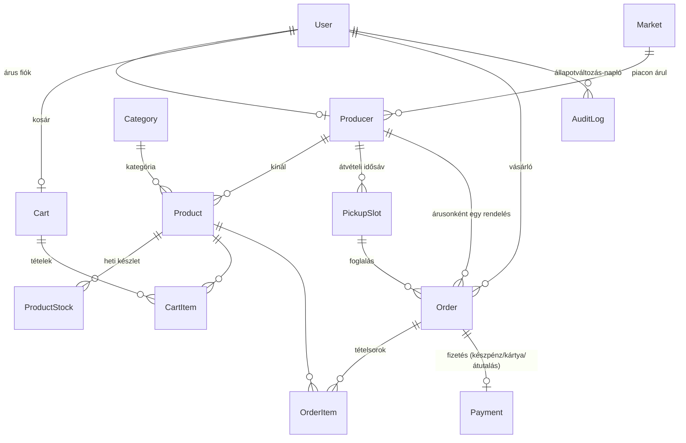

# Adatmodell

A modell a `localmarket-preordersystem.Domain/Entity` osztályaira és az `Infrastructure/Persistence/Configurations` EF konfigurációkra épül (PostgreSQL).

| Entitás | Szerep |
|---|---|
| User | felhasználó, szerepkör: Customer / Producer / Admin |
| Market | piac, nyitvatartási napok (admin állítja) |
| Producer | árus adatlap, jóváhagyási állapot |
| Category, Product | termékek, mértékegység, allergének |
| ProductStock | heti készlet és ár (`xmin` optimista konkurencia) |
| PickupSlot | átvételi idősáv, `BookedCount` |
| Cart, CartItem | több árusból álló kosár |
| Order, OrderItem | rendelés és tételsorok, állapotgép |
| Payment | fizetési mód és állapot |
| Logs (AuditLog) | kritikus módosítások naplója |

## Rendelés-állapotgép

`Pending -> Accepted | PartiallyFulfilled | Rejected | Cancelled -> Ready -> PickedUp | NotPickedUp -> Disputed -> (admin döntés)`
